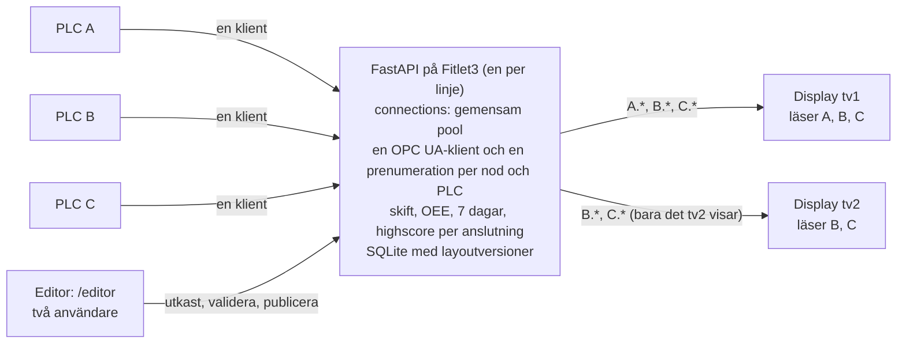
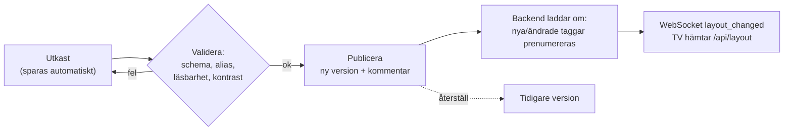

# Plan: verktyg för att designa dashboards (editor)

> **Status: inriktningen är beslutad** (Johans svar 19 okt 2026, se [Beslut](#beslut)).
> - **Klart:** etapp 0 (spik, PR #18) och etapp 1 (dokument och renderare, PR #19).
> - **Etapp 2 (MVP-editor) pågår:**
>   - modellen för flera PLC:er per display och den förenklade headern (PR #20)
>   - inloggning och editorns skal på `/editor/` med display, skärmlista och förhandsvisning (PR #23)
>   - sedan duken, egenskapspanelen och publiceringen
> - **Driften** stöder fortfarande en PLC och en display tills etapp 4. Se
>   [CONFIG.md](CONFIG.md#layoutdokumentet-schema_version-2).

Målet är ett verktyg där man bygger TV-dashboards som vår från grunden: väljer elementtyper, kopplar OPC UA-taggar, drar och
släpper, ändrar ordning och storlek, sätter tema och logotyper och publicerar till TV:n. Resultatet ska se **helt eget** ut
(kundens färger, logotyper och typsnitt) och aldrig som en standardprodukt.

- [Mål och icke-mål](#mål-och-icke-mål)
- [Beslut](#beslut)
- [Alternativ och rekommendation](#alternativ-och-rekommendation)
- [Arkitektur](#arkitektur)
- [Layoutmodell och dokument](#layoutmodell-och-dokument)
- [Elementkatalog och egenskapspanel](#elementkatalog-och-egenskapspanel)
- [Läsbarhetsspärrar](#läsbarhetsspärrar)
- [Tema och varumärke](#tema-och-varumärke)
- [OPC UA-taggar: bläddra och koppla](#opc-ua-taggar-bläddra-och-koppla)
- [Dra och släpp: val av bibliotek](#dra-och-släpp-val-av-bibliotek)
- [Redigering, spara och publicera](#redigering-spara-och-publicera)
- [Backend-API](#backend-api)
- [Säkerhet](#säkerhet)
- [Test](#test)
- [Etapper](#etapper)
- [Risker](#risker)
- [Kvarstående frågor](#kvarstående-frågor)

## Mål och icke-mål

**Mål**

- Bygga och ändra skärmar utan att röra kod eller YAML för hand: elementpalett, fri placering på ett rutnät, flytta, ändra
  storlek och ordning, kopiera, ångra.
- Koppla element till PLC-taggar genom att **bläddra i OPC UA-servern** (träd och sök) och se livevärdet direkt.
- **Eget utseende per kund:** tema (färger, typsnitt, kort, bakgrund) och logotyper, redigerbart i verktyget.
- **Läsbarheten är inbyggd:** samma regler som idag (hjältesiffror minst 90 px versalhöjd vid 1080p, inget under 37 px,
  aldrig overflow eller scroll) kontrolleras medan man redigerar och blockerar publicering när de bryts.
- Versioner med återställning, och publicering utan omstart: TV:n byter layout själv.
- Demoläge med simulerade värden, så att man kan designa utan PLC.

**Icke-mål**

- **Ingen styrning av PLC:n.** Verktyget skriver aldrig till OPC UA, bara läser och bläddrar. Dashboarden förblir en ren
  visningsyta och PLC:n styr fortfarande `ActiveScreenNr`.
- Ingen interaktion på TV:n (inga knappar, ingen kvittering), ingen SCADA och inga skript eller formler i editorn.
- Ingen generell BI- eller rapportbyggare. Beräkningarna (OEE, skift, 7 dagar, highscore) stannar i backend och kod.
- Ingen pixelfri "Photoshop-yta" i första versionen. Element hamnar på ett rutnät, se [Layoutmodell](#layoutmodell-och-dokument).

## Beslut

Johans svar på de öppna frågorna (19 okt 2026):

| # | Fråga | Beslut | Följd i planen |
|---|---|---|---|
| 1 | Källa | **Databasen** (versionerat dokument i SQLite). YAML bara import och export | se [Layoutmodell](#layoutmodell-och-dokument) |
| 2 | Vem redigerar | **Johan och en kollega.** Enkel inloggning för två användare, inga roller | se [Säkerhet](#säkerhet) |
| 3 | Installationer | **En Fitlet3 per linje med flera displayer.** Displayerna har olika innehåll och kan läsa från **olika PLC:er** | flera anslutningar och flera displayer, se [Arkitektur](#arkitektur) |
| 4 | Inbyggda skärmar | OEE, 7 dagar, highscore och skiftmönster kan **även placeras som mindre widgets** | minsta storlek per typ, se [Elementkatalog](#elementkatalog-och-egenskapspanel) |
| 5 | Rutnät | **Fast rutnät** (24×12, ingen överlappning) **och en header-yta utanför rutnätet per display**, som är beständig och anpassningsbar | se [Header-yta](#header-yta) |
| 6 | Demo | **Editorn finns i Pages-demon**, med lagring i `localStorage` | se [Redigering](#redigering-spara-och-publicera) |
| 7 | Larm | **Larmskärmen är alltid helskärm** | valideras |

Johans svar före etapp 2 (19 okt 2026):

| # | Fråga | Beslut |
|---|---|---|
| 8 | `dashboard.yaml` efter editorn | `LAYOUT_YAML_IMPORT=auto` importerar en ändrad fil **bara tills editorn har publicerat första gången**. Därefter vinner editorn. `always` importerar ändå, `off` aldrig |
| 9 | Minsta storlek | Värdeelement minst 12×4 rutor och inbyggda skärmar helskärm, tills de beräknade läsbarhetskontrollerna tillåter mindre |
| 10 | Display-adress | `/?display=tv2` |
| 11 | Taggändringar | Kräver omstart av backend fram till etapp 4 |
| 12 | Header | **Bara två logotyper och klockan:** logotyp till vänster, klocka i mitten och logotyp till höger. Varje logotypplats väljer tillgång (`customer`, `vendor`) eller är tom (`none`). Ingen text och ingen skärmtitel |
| 13 | Inloggning | Två lokala konton i SQLite med argon2-hash, skapas med `python -m backend.users add <namn>` (frågar efter lösenord). Ingen registreringssida. Sessionskaka och inloggning på `/editor` i fabriksnätet. Pages-demons editor har ingen inloggning, sparar bara i `localStorage`, visar påhittade värden och kan aldrig nå en riktig PLC |
| 14 | Flera PLC:er per display | En display kan läsa **flera PLC:er** och PLC:er **delas** mellan displayer (TV1 läser A, B och C, TV2 läser B och C). `connections` är en gemensam pool med **en OPC UA-klient per PLC**. Taggar skrivs med anslutning (`plc2.OEE`) eller kort med displayens `default_connection`. Skärmväxlingen pekar på en anslutning. Inbyggda skärmar anger sin anslutning (linje). Historiken sparas per anslutning. Modell, validering och migrering finns från etapp 2. Driften med flera PLC:er kommer i etapp 4 |

## Alternativ och rekommendation

Tre vägar har utvärderats (oktober 2026):

- **A. Bygg vidare på dagens stack:** `dashboard.yaml` är fortfarande källan, och en React-editor läser och skriver filen.
- **B. Ny grund:** eget layoutdokument (JSON) med versioner i SQLite, YAML som import och export, egen renderare med
  temamotor och en editor byggd på bibliotek.
- **C. Färdiga verktyg:** Grafana, Node-RED Dashboard 2.0 (FlowFuse), FUXA och lågkodsverktyg (Appsmith, ToolJet).

| Kriterium | A: YAML + editor | **B: ny grund (rekommenderas)** | C1: Grafana + OPC UA | C2: Node-RED Dashboard 2.0 | C3: FUXA | C4: Appsmith/ToolJet |
|---|---|---|---|---|---|---|
| Eget utseende (tema, logotyper, typsnitt, layout) | Fullt, men tema i YAML blir krångligt | **Fullt, temamotor och temaeditor** | Begränsat: Grafana-utseende, bara paneltema | Delvis: Vuetify-tema och CSS-mallar | Delvis: SVG-ritning och fri stil, eget HMI-utseende | Delvis: app-utseende |
| Editor (dra, släpp, storlek) | Ja, byggs | **Ja, byggs** | Ja, panelrutnät | Ja, grupper och widgets i flöden | Ja, fri SVG-editor | Ja |
| OPC UA | asyncua finns | **asyncua finns** | Plugin "Simple OPC-UA" (Apache-2.0, v1.1, maj 2026), officiell plugin arkiverad | node-red-contrib-opcua eller FlowFuse Certified Node | Inbyggd OPC UA och S7 | Nej, kräver eget API |
| TV/kiosk och läsbarhet (90/37 px, ingen overflow) | Ja, egen kontroll | **Ja, egen kontroll och spärrar** | Nej, ingen spärr, text skalar fritt | Nej, responsiv layout utan läsbarhetsspärrar | Delvis, fast upplösning men inga spärrar | Nej |
| Behåller OEE, skiftlogg, 7 dagar, highscore | Ja | **Ja** | Nej, måste skrivas om som frågor | Nej, måste byggas i flöden | Nej, egen datamodell | Nej |
| Offline på Fitlet3 | Ja | **Ja** | Ja, tung | Ja | Ja | Tung, kräver extra databaser |
| Licens | MIT (eget) | **eget + MIT-bibliotek** | AGPL-3.0 (Grafana) | Apache-2.0 | MIT (Pro €100 för white-label) | Apache-2.0/AGPL med betalnivåer |
| Underhåll | Vårt | **Vårt + aktiva bibliotek** | Aktivt | Aktivt (v1.33, okt 2026) | Aktivt (v1.3.4, aug 2026) | Aktivt |
| Insats | Liten–medel | **Medel–stor** | Liten att starta, stor för att nå vårt utseende | Medel | Medel, och mycket av vårt går förlorat | Stor |

**Rekommendation: B, med det som fungerar i A.**

- **C avvisas:**
  - Grafana och Node-RED ger deras utseende, inte vårt.
  - Ingen av dem har spärrar för läsbarhet på 8–10 m.
  - Vår beräkningslogik måste byggas om i deras modell.
  - FUXA är det närmaste (MIT, OPC UA, web-editor), men det är en HMI/SCADA med eget Angular/SVG-gränssnitt, styrfunktioner
    och white-label först i Pro-versionen. Det används bara som **inspiration**, för taggträdet och bindningsdialogen.
- **A räcker inte för tema, versioner och flera kunder.** En YAML-fil med kommentarer är bra för handredigering men dålig
  som lagring för en editor: samtidiga ändringar, ångra och historik, och tema- och tillgångsreferenser.
- **B behåller allt som redan fungerar:**
  - backend med asyncua och `DataStore`;
  - SQLite med en enda skrivtråd och historik;
  - OEE, skiftloggen (`shifts`), 7 dagar och highscore (`run_records`);
  - WebSocket-flödet och demokällan;
  - canvasen på 3840×2160 (`ScaledCanvas`), `useFit` och `check-fit`;
  - de inbyggda skärmarna;
  - pydantic-valideringen, som får nya modeller.

  Nytt blir layoutdokumentet med versioner, rutnätsrenderaren, temamotorn, editorn och API:t för att bläddra i OPC UA.

## Arkitektur



- **Gemensam pool med PLC:er (`connections`):**
  - Varje anslutning är en PLC med URL, taggar (alias till nod-id), larm och egen inloggning i `.env`. Den första
    anslutningen använder dagens namn, övriga får prefix, t.ex. `PLC2_OPC_PASSWORD`.
  - Backend öppnar **en OPC UA-klient per PLC** och prenumererar **en gång per nod**, oavsett hur många displayer som
    använder den. Värdena skickas ut till alla displayer som behöver dem (`subscription_plan` i `backend/layout_doc.py`).
- **Displayer läser flera PLC:er:**
  - Varje display (TV) har ett id (`tv1`, `tv2` …), egna skärmar och egen header.
  - Ett element anger sin tagg med anslutning, `plc2.OEE`. Ett kort namn (`OEE`) gäller displayens `default_connection`,
    så dagens filer fungerar oförändrade.
  - Flera displayer kan läsa samma PLC. TV:n väljer display med `/?display=tv1`. Utan parameter visas den första.
- **Skärmväxling per display:** `screen: {connection, active, requested}` pekar på en anslutning och dess noder.
- **Inbyggda skärmar per linje:**
  - OEE, skiftmönster, 7 dagar, highscore och larm anger sin anslutning (`connection: plc1`).
  - Skiftlogg, OEE-beräkning och run-tabeller får en `connection`-kolumn. Befintliga rader tillhör den första
    anslutningen.
- **WebSocket per display:**
  - Värdena skickas med anslutningens id (`data_update {connection, key}`), och TV:n håller dem isär (`plc1.OEE`).
  - En display får bara de värden den visar (`display_keys`). Etapp 4 filtrerar per klient, så överlappande displayer
    inte ger dubbel last.
- **En PLC som tappar kontakten** påverkar bara elementen som är kopplade till den. De visar `–` och ⚠
  (`connection_status`), medan övriga fortsätter att uppdateras.
- **Etapper:** etapp 1–2 har **modellen**, valideringen, migreringen och TV:ns hantering av flera anslutningar. Driften med
  flera klienter, historik per anslutning och filtrering per display kommer i etapp 4. Till dess stöder driften en
  anslutning och en display (valideras med ett tydligt fel).
- **Skärmväxlingen** fungerar som idag: PLC:n begär en skärm, backend kvitterar genom att skriva `ActiveScreenNr` till
  PLC:n, och TV:n skriver aldrig. Det är den enda skrivningen till PLC:n. Den görs av backendens drift, aldrig av editorn.

- **En backend, två appar:** FastAPI serverar både TV-appen (`/`) och editorn (`/editor`) från samma byggda frontend
  (Vite multi-page). Detta hänger ihop med "Docker för drift på Fitlet3" i ROADMAP, där FastAPI ändå ska servera
  frontenden. TV:ns kioskwebbläsare öppnar aldrig `/editor`.
- **Delad renderare:** samma React-komponenter ritar skärmen på TV:n, i editorns canvas och i förhandsvisningen, så det man
  ser i editorn är exakt det TV:n visar. Koden delas upp i `renderer/` (TV och editor), `tv/` och `editor/`.
- **Editorn ska fungera på en bärbar dator i fabriksnätet** (Chrome/Edge, mus och tangentbord). Surfplatta med touch är bra
  att ha men inget krav i MVP.

## Layoutmodell och dokument

**Rutnät:** innehållsytan under [header-ytan](#header-yta) på canvasen 3840×2160 delas i **24 kolumner × 12 rader** med
fast mellanrum.

- Rutnätet växer **aldrig** nedåt: det finns ingen kompaktering och inga extra rader, så skärmen kan inte scrolla.
- Ett element har `x, y, w, h` i rutor och kan inte överlappa andra.
- Fast höjd passar en TV bättre än dagens fasta 2-kolumnsrutnät och bättre än en responsiv layout. Canvasen skalas redan
  likformigt till TV:ns upplösning.

**Dokument (JSON, valideras av pydantic):**

```text
LayoutDocument
  schema_version: 2
  connections: { id: Connection }                      # gemensam pool, en per PLC (en OPC UA-klient var)
  displays:    { id: Display }                         # en per TV
Connection
  name?, url?, alarms                                  # lösenord och certifikat i .env
  tags: { alias: { node, type, demo? } }               # alias = taggnamn inom anslutningen
Display
  name, default_connection?, theme
  screen: { connection, active, requested }            # skärmväxlingens noder på en anslutning
  header: { left, right }                              # customer | vendor | none, klockan i mitten
  screens: { nr: Screen }                              # nr = ActiveScreenNr
Screen
  title
  items: [ { id, kind, x, y, w, h, ...egenskaper } ]   # tag: plc2.OEE (eller OEE med default_connection)
                                                       # inbyggda: connection = linjen de visar
```

- **Inbyggda skärmar** (skiftmönster, OEE, 7 dagar, highscore) är element. Fyller de hela rutnätet (`0,0,24,12`) ritas de
  precis som idag (helskärm). Från etapp 6 kan de vara mindre, ned till sin minsta storlek. **Larm är alltid helskärm.**
- **Databasen är källan (beslut 1):**
  - Tabellen `layout_versions` (id, tid, författare, källa, kommentar, json) och en pekare till den publicerade versionen.
  - Raderas aldrig av gallringen. Varje publicering ger en ny version som kan återställas.
  - pydantic-modellerna genererar JSON Schema, och det genererar TS-typer, så backend och frontend kan inte glida isär.
- **YAML bara som import och export:**
  - **Första start:** `dashboard.yaml` (dagens format eller nya formatet med `schema_version: 2`) importeras och publiceras
    som version 1.
  - **Senare ändringar av filen:** vid start importeras filen bara om den har ändrats sedan senaste importen (hash). Det
    behövs tills editorn finns (etapp 2), eftersom filen då är enda sättet att ändra något. Varje import blir en ny version,
    så det som fanns innan kan återställas.
  - Export skrivs med `ruamel.yaml` och kommentarer från modellbeskrivningarna, så filen kan versioneras i git.
  - Nod-id:n och lösenord blandas inte: lösenord och certifikat stannar i `.env`.
- **Migrering av dagens `dashboard.yaml`:**
  - grid-skärm med 1 objekt: `0,0,24,12`;
  - fler objekt: 2 kolumner med `w = 12` och `h = 12 / rader` (3 rader ger `h = 4`), i samma ordning som idag;
  - övriga skärmtyper blir ett helskärmselement;
  - `opc:` och `tags:` blir anslutningen `plc1`, och skärmarna blir displayen `tv1` med dagens header.

  Ett test visar att de migrerade skärmarna ser ut som idag (skärmdumpar jämförs).

### Header-yta

Varje display har en **header-yta ovanför rutnätet** (beslut 5 och 12). Den ligger kvar när skärmarna växlar och påverkar
inte rutnätet.

- **Fast utformning:** logotyp till vänster, klocka i mitten och logotyp till höger.
- **Logotypplatserna:** varje plats väljer tillgång, `customer` (kundlogotyp) eller `vendor` (ABECE), eller `none`
  (tom). Från etapp 5 kan den också vara en uppladdad bild. Det finns ingen text och ingen skärmtitel.
- **Standard = dagens header:** kundlogotyp, klocka, ABECE.
- **Höjd och utseende:** headerns höjd är fast (klockans 200 px), så rutnätet får samma storlek oavsett logotyper. Bakgrund
  och kantlinje kommer från temat (etapp 5).
- **Demon:** där visas alltid platshållarlogotypen och märket "DEMO".
- **Äldre versioner:** dokument sparade i etapp 1 hade tre fria platser. De läses fortfarande. En logotyp behålls, och allt
  annat blir `none`.

## Elementkatalog och egenskapspanel

Varje elementtyp definieras på ett ställe:

- vilka egenskaper den har (de genererar panelen);
- vilka datatyper den passar;
- standardstorlek;
- **minsta storlek**, beräknad så att värsta fallets text får plats med läsbar storlek, se nästa avsnitt.

| Typ | Visar | Bindning | Anmärkning |
|---|---|---|---|
| `number` | tal med enhet och decimaler | numerisk tagg | finns idag |
| `counter` | antal mot mål, 6 siffror | heltal + mål (tagg eller fast) | finns idag |
| `percent` | procent med gränsfärger | numerisk tagg | finns idag |
| `time` | `hh:mm:ss` | S7 TIME/TOD, sekunder | finns idag |
| `status` | text och färg per tillstånd | heltal eller bool | finns idag |
| `bar` | stapel mot mål eller max | numerisk tagg + mål | nytt |
| `gauge` | båge med värde i mitten | numerisk tagg | nytt, kräver stor ruta (bågen ska bära siffran, inte tvärtom) |
| `sparkline` | trendlinje 1 h | numerisk tagg | finns som del av kort idag, blir eget element |
| `text` | fast text eller texttagg | sträng | rubriker och instruktioner |
| `image` / `logo` | uppladdad bild, logotypplats | tillgång | se Tema |
| `clock` | klocka och datum | ingen | dagens header-klocka som element |
| `oee`, `week`, `highscore`, `shift` | inbyggda skärmar | backend-beräkning | helskärm tills etapp 6, sedan även mindre (minsta storlek per typ) |
| `alarms` | larmlistan | larm från PLC:n | **alltid helskärm** |

**Egenskapspanel:**

- Etikett, bindning (taggväljare), enhet, decimaler, mål, gränser och färger, tillstånd för `status`, och tema-överstyrning
  (bara semantiska färger, inga fria hex-koder i elementen).
- Panelen genereras från elementets egenskapsschema, så en ny elementtyp kräver ingen ny panelkod.

## Läsbarhetsspärrar

Reglerna gäller vid 1080p, alltså 1920×1080 med canvasen skalad 0,5: hjältesiffror minst **90 px versalhöjd**, ingen text
under **37 px**, aldrig overflow eller scroll.

- **Live-storlek:** editorn räknar för varje element fram vilken textstorlek rutan ger. Den använder samma `useFit` som TV:n
  och värsta fallets värden (`999 999`, `00:00:00`, `555:33:18`, långa etiketter och lag `A→B`). Versalhöjden visas i rutan,
  t.ex. "värde 94 px · etikett 41 px".
- **Spärrar:**
  - Under 37 px är rutan **röd och går inte att publicera**.
  - Hjälteelement (ett per skärm kan markeras) under 90 px ger en **varning**.
  - Vid storleksändring stannar handtaget vid elementtypens minsta storlek.
- **Live fit-check:** DOM-kontrollen i `scripts/check-fit.mjs` (klippt overflow, minsta storlek) flyttas till en modul,
  `fitAudit()`. Samma modul körs i editorn efter varje ändring och i puppeteer i CI.
- **Förhandsvisning vid fem upplösningar** (1280×720, 1366×768, 1920×1080, 2560×1080, 3840×2160), plus ett läge med värsta
  fallets värden.
- **Uppmätta typsnittsmått:** versalhöjden räknas från uppmätta typsnittsmått (versalhöjd per typsnitt, mätt när typsnittet
  laddas), inte en fast faktor. Uppladdade typsnitt ger då korrekta värden.

## Tema och varumärke

Allt utseende går genom **tema-tokens** (CSS-variabler). Komponenterna använder bara tokens, aldrig fasta färger. Dagens
utseende blir standardtemat "ABECE mörk".

**Temamodell:**

- **Palett:**
  - Bakgrund, yta, yta 2, kantlinje, text och dämpad text.
  - Semantiska statusfärger: `ok` (kör, på mål), `warn`, `alarm`, `neutral` och `info`, plus accent.
  - Status visas alltid också med text eller symbol (t.ex. "PÅ MÅL", "LINJEN STÅR"), aldrig bara med färg.
- **Typografi:**
  - Sans- och mono-familj, vikter.
  - Siffror är alltid `tabular-nums`, så värden inte hoppar.
  - Typsnitt laddas upp (woff2) eller väljs bland inbyggda, och servas lokalt på Fitlet3 (inga externa typsnitts-CDN).
- **Logotyper:** platser för kundlogotyp, leverantörslogotyp (ABECE) och valfri sekundär logotyp, med placering i headern
  (vänster, mitten eller höger) och maxhöjd.
- **Bakgrund och kort:**
  - Bakgrunden är enfärgad, en gradient eller en bild med obligatorisk mörk toning, så att kontrasten håller.
  - Kortens hörnradie, kantbredd och skugga.
  - Header-layout: klocka, titel och logotyper.
- **Nivåer:** tema per display och överstyrning per skärm. Mörkt tema är standard, eftersom ljusa ytor bländar på en stor TV.

**Temaeditor i verktyget:**

- Färgväljare med förhandsvisning av en provskärm (alla elementtyper och statusar) bredvid.
- Mallar att utgå från: mörk, mörk hög kontrast och ljus.
- Teman kan importeras och exporteras som JSON.

**Kontrastspärrar** (kontrastkvot enligt WCAG 2):

- Text mot sin yta minst 7:1 och statusfärger mot ytan minst 4,5:1.
- **Bländningstest:** 15 procent vitt läggs över både förgrund och bakgrund, och kvoten ska fortfarande vara minst 3:1.
- Statusfärgerna `ok`, `warn` och `alarm` ska skilja sig tydligt från varandra, även i färgblindsimulering
  (deuteranopi/protanopi).
- Brott visas i temaeditorn och blockerar publicering, på samma sätt som läsbarhetsspärrarna.

**Tillgångar (logotyper, bilder, typsnitt):**

- **Uppladdning:**
  - Laddas upp i editorn och sparas på Fitlet3 i datakatalogen (t.ex. `data/assets/`, monterad volym i Docker).
  - Adresseras med innehållshash: `/assets/<hash>.<ext>`.
  - Tillåtna format: PNG, WebP, SVG och woff2, med storleksgräns.
  - SVG saneras (inga skript eller externa referenser).
- **Aldrig i git eller i den publika demon:**
  - GitHub Pages-demon använder bara platshållare (`demoLogo.svg`) och ett demotema.
  - Dagens `frontend/public/customerLogo.png` flyttas ut ur repot i samma veva. Den publiceras inte på Pages i dag, men
    ligger i git.
- **Export och backup:** exporten av ett dokument kan ta med tillgångarna som en zip, för backup eller flytt mellan
  installationer.

## OPC UA-taggar: bläddra och koppla

- **Bläddra:**
  - Backend använder den befintliga asyncua-anslutningen (med lås) för att bläddra nivå för nivå i adressrymden
    (HierarchicalReferences), med cache.
  - Editorn visar ett **träd** med DisplayName, NodeClass och datatyp.
- **Sök:**
  - Ett bakgrundsjobb går igenom trädet från valda rötter, t.ex. `DB Production TV`, med tak för djup och antal noder.
  - Det bygger ett sökindex på BrowseName, DisplayName och nod-id.
  - Indexet byggs bara på begäran och med låg takt, så PLC:n inte belastas.
- **Livevärde:**
  - Den valda noden läses (Value, DataType, AccessLevel) och prenumereras tillfälligt.
  - Högst 20 noder åt gången, och prenumerationen släpps automatiskt efter 60 s utan editor.
- **Typförslag:**

  | OPC-datatyp | Förslag |
  |---|---|
  | Boolean | `status` |
  | heltal | `counter` eller `number` |
  | Float/Double | `number` med decimaler |
  | S7 TIME/TOD (ms) | `time` |
  | String | `text` |
  | värde 0–100 med namn som "oee" eller "%" | `percent` |

- **Alias:**
  - Element binder till ett **alias**, t.ex. `GoodCount`, inte direkt till ett nod-id. Byts noden i PLC:n ändras bara aliaset.
  - Aliaslistan är dagens `tags:`.
  - Backendens beräkningar (OEE, skift, highscore) använder fasta alias, och editorn varnar om de saknas.
  - Manuell inmatning av nod-id finns kvar för när bläddring inte fungerar.

## Dra och släpp: val av bibliotek

| Bibliotek | Licens, senaste version | React 19 | Passar oss? |
|---|---|---|---|
| **react-grid-layout** v2 | MIT, 2.2.3 (mars 2026), TS-omskrivning | Fungerar (kräver React 18+), peer `>=16.3` | **Ja, för canvasen:** dra, storlek med handtag, kollision, gränser, ingen kompaktering, drop utifrån, `maxRows` |
| gridstack.js | MIT, v14 (sep 2026), React-wrapper | Ja | Bra alternativ (`cellHeight: 'fill'` passar fast höjd), men äger DOM:en och portalar in React. Reserv om react-grid-layout inte klarar den skalade canvasen |
| dnd-kit (`@dnd-kit/react`) | MIT, 0.5.1 | Ja | **Ja, för listor:** skärmordning och elementlista (sortable). Har ingen storleksändring eller rutnätsmotor, så den räcker inte för canvasen |
| Puck | MIT, 0.23 (aug 2026) | Ja | Bra panel och outline, men bygger på flöde och slots, inte fri rutnätsplacering. Vi lånar mönstret (elementdefinition med fält som genererar panelen), inte biblioteket. Kan prövas i en spik |
| craft.js | MIT, React 19 sedan feb 2025 | Ja | Låg aktivitet, avvisas |
| GrapesJS | BSD-3, 0.23.8 | Wrapper v2 | HTML/CSS-byggare som inte renderar våra React-komponenter i canvasen, avvisas |
| react-moveable | MIT, 0.56 (dec 2023) | Oklart | Fri transform, men ounderhållet sedan 2023, avvisas |

**Rekommendation:**

- **react-grid-layout v2** för canvasen, med kompaktering avstängd, kollision förhindrad, gränser på och fasta 12 rader.
- **dnd-kit** för sorterbara listor.
- Egen egenskapspanel från elementschemat.
- `zustand` (finns redan) för editorns tillstånd, med patch-baserad ångra/gör om.

**Skäl:** React-native och TypeScript, stabilt (2,6 miljoner nedladdningar per vecka), handtag och kollision finns färdiga,
och layouten serialiseras direkt till `x, y, w, h`.

**Spiken (etapp 0) löste risken med den skalade canvasen:** bibliotekets `createScaledStrategy` utgår från att rutnätet
börjar i fönstrets hörn. Under vår header-yta hamnar y därför cirka 2 rader fel (9 av 30 kontroller godkända). En egen
`positionStrategy` på 10 rader drar av rutnätets position innan den delar med skalan. Den klarade 30 av 30 kontroller
(dra, storlek, kollision och gränser) i sex fönsterstorlekar från 1280×720 till 3840×2160, även 21:9 och 4:3. Gridstack
behövs inte. Detaljer och mått finns i [spikes/editor-rgl](../spikes/editor-rgl/README.md).

## Redigering, spara och publicera

- **Skärmhantering:**
  - Lista med skärmnummer, där numret är det `ActiveScreenNr` PLC:n skickar.
  - Man kan lägga till, duplicera, numrera om (dubbletter spärras) och ta bort skärmar.
  - Ordningen i demons cykel kan dras om.
- **Redigering:**
  - Ångra och gör om (Ctrl+Z / Ctrl+Y), kopiera, klistra in och duplicera, även mellan skärmar.
  - Pilar flyttar en ruta och Shift+pil ändrar storlek.
  - Flera element kan markeras.
- **Flödet:**



- **Utkast och versioner:**
  - Utkast sparas löpande på servern, inte bara i webbläsaren.
  - Publicering skapar en ny version. Tidigare versioner kan visas, jämföras och återställas.
  - YAML-export av varje version finns som backup.
- **Omladdning utan omstart:**
  - Konfigurationscachen töms (i dag `lru_cache` i `get_dashboard`).
  - Taggändringar räknas fram, nya noder prenumereras och borttagna släpps. I första versionen räcker det att starta om
    OPC-sessionen.
  - TV:n får `layout_changed` och hämtar layouten igen (i dag hämtas den bara vid start).
- **Förhandsvisa på TV:n:** en tidsbegränsad länk (`/?preview=<token>`) visar utkastet på en riktig TV utan att publicera.
- **Demoläge i editorn:**
  - Växeln "Simulerat / Live" använder demokällan (som Pages-demon) med värden per alias och datatyp, inklusive
    värsta fallets värden.
  - **Pages-demon får editorn (beslut 6):** den sparar i `localStorage`, behöver ingen backend och visar bara demotema och
    platshållare. "Återställ demo" tömmer lagringen.

## Backend-API

TV-delen, utan inloggning och bara läsning:

| Metod | Sökväg | Syfte |
|---|---|---|
| GET | `/api/layout?display=tv1` | publicerad layout för en display: skärmar med `x, y, w, h`, header, tema och taggtyper (inga nod-id) |
| GET | `/api/displays` | lista över displayer (id och namn) |
| WS | `/ws` | nytt meddelande `layout_changed {version}` |
| GET | `/assets/<hash>.<ext>` | logotyper, bilder, typsnitt (cachebara) |

Editor-delen, med inloggning, under `/api/editor`:

| Metod | Sökväg | Syfte |
|---|---|---|
| POST/POST/GET | `/login`, `/logout`, `/session` | session (klart, etapp 2a) |
| GET | `/document` | publicerat dokument med nod-id, för editorn (klart, etapp 2a) |
| GET/PUT | `/draft` | läs och spara utkast |
| POST | `/validate` | schema, alias, läsbarhet (server-sida), kontrast |
| POST | `/publish` | ny version med kommentar |
| GET | `/versions`, `/versions/{id}` | historik |
| POST | `/versions/{id}/restore` | återställ som nytt utkast |
| GET/POST | `/export.yaml`, `/import` | YAML (och zip med tillgångar) |
| POST | `/preview-token` | förhandsvisningslänk för TV |
| GET | `/opc/browse?node=`, `/opc/search?q=`, `/opc/read?node=` | bläddra, sök, läs attribut |
| WS | `/opc/watch` | tillfälliga livevärden för valda noder (max 20) |
| POST/GET/DELETE | `/assets` | ladda upp, lista och ta bort tillgångar |

## Säkerhet

- **TV:n är bara visning:** `/` och `/api/layout` kräver ingen inloggning, och inget TV-API kan ändra något, som idag.
- **Editorn kräver inloggning:**
  - **Två användare (beslut 2), Johan och en kollega, inga roller:** användarna läggs in med
    `python -m backend.users add <namn>`, och lösenordet lagras som argon2-hash i SQLite. Publiceringar loggas med namn.
  - **Sessionskaka och skydd:** sessionskakan har `HttpOnly`, `SameSite=Strict` och `Path=/api/editor` och gäller i
    12 h. Ändrande anrop kräver huvudet `X-Editor: 1` (mot CSRF). Inloggningen spärras i 5 minuter efter 5 fel från
    samma adress. Byggt i etapp 2a, se [CONFIG.md](CONFIG.md#editorn-konton-och-inloggning).
  - **Demo-editorn** (Pages) har ingen inloggning och ingen backend. Den använder påhittade nod-id och `localStorage`.
  - Editorn kan bindas till ett eget gränssnitt eller en egen port, så den inte nås från TV-nätet.
  - HTTPS med ett lokalt certifikat rekommenderas.
- **Aldrig skrivning till PLC:n:**
  - Bläddrings-API:t går genom en omslagsklass som bara exponerar Browse, Read och tillfälliga prenumerationer.
  - Ett test kontrollerar att ingen kod under `/api/editor` anropar asyncuas `write_value`/`set_value`.
  - Dessutom bör OPC-användaren bara ha läsrätt i PLC:n (driftpunkt).
- **Belastning:** bläddring och sökning har tak och låg takt, så editorn inte kan störa prenumerationen till TV:n.
- **Tillgångar:** typ- och storlekskontroll, sanerad SVG och innehållshash som filnamn. Inget som laddas upp körs.
- **Granskning:** varje publicering loggas med användare, tid och kommentar.

## Test

- **Backend (pytest):**
  - Dokumentmodeller och validering.
  - Migrering: dagens `dashboard.yaml` till ett dokument och tillbaka, och export följt av import ger samma dokument.
  - Versioner och återställning.
  - Auth: alla editor-endpoints ger 401 utan session.
  - Kontrastfunktionen.
  - Omladdning med taggdiff.
  - Bläddring mot en asyncua-testserver (`asyncua.Server` i testet) och testet att ingen kod skriver till PLC:n.
- **Frontend:**
  - Vitest (planerat i ROADMAP) för ångra/gör om, kollisionsregler, minsta storlek, versalhöjdsberäkning och kontrast.
  - **Playwright e2e** mot `vite preview` med demokälla: dra in, flytta, ändra storlek, spärr vid minsta storlek,
    tangentbord, kopiera/klistra, ångra, publicera (mockad backend), förhandsvisning.
- **Fit-check återanvänds:**
  - `check-fit.mjs` kör `fitAudit()` på valfria dokument (`--doc`) vid alla fem upplösningarna med värsta fallets värden.
  - CI kör den på exempel- och stressdokumenten.
  - Skärmdumpar av de migrerade skärmarna jämförs mot dagens rendering.

## Etapper

Uppskattningen utgår från hur vi arbetar: en AI implementerar och varje funktion hittills (t.ex. 7 dagar, skiftloggen,
highscore) har tagit cirka 30–60 min inklusive tester, CI och merge. Därför anges PR-iterationer och ungefärliga timmar
implementation, inte arbetsdagar.

| Etapp | Innehåll | PR | Implementation |
|---|---|---|---|
| 0. Spik och beslut | react-grid-layout v2 i den skalade canvasen (reserv gridstack), Puck-test för panelen, mätning av typsnittsmått | 1 | ca 1 h |
| 1. Dokument och renderare | ny dokumentmodell (anslutningar, displayer, header-yta, skärmar med `x, y, w, h`), migrering från `dashboard.yaml`, `layout_versions` (databasen är källan), `/api/layout?display=`, rutnätsrenderare och header från dokumentet, `layout_changed`. **TV:n ser likadan ut som idag** | 2–3 | 2–4 h |
| 2. **MVP-editor** | `/editor` med inloggning, skärmlista, canvas (dra, släpp, storlek, ordning), dagens 5 elementtyper + inbyggda skärmar som helskärm, egenskapspanel, taggväljare (alias och manuellt nod-id), läsbarhetsspärrar med live `fitAudit`, ångra/gör om, kopiera/klistra, utkast, validering, publicering, återställning, YAML-export, demoläge | 3–5 | 4–8 h |
| 3. OPC-bläddring | träd, sök, livevärde, typförslag, skapa alias från nod | 1–2 | 2–3 h |
| 4. Flera PLC:er och displayer i drift | en runtime-kontext per anslutning (OPC-klient, DataStore, skift, OEE, 7 dagar, highscore), `connection`-kolumn i historiken, skärmväxling per display, `.env` per anslutning | 2–4 | 4–8 h |
| 5. Tema och varumärke | tema-tokens (dagens utseende som standardtema), temaeditor, kontrast- och bländningsspärrar, uppladdning av logotyper, bilder och typsnitt, header-ytans utseende | 2–3 | 3–5 h |
| 6. Nya elementtyper | `bar`, `gauge`, `sparkline`, `text`, `image`, `clock`, inbyggda skärmar i mindre storlek (utom larm) | 2–4 | 3–5 h |
| 7. Finputs | förhandsvisning på TV via länk, editor i Pages-demon, full Playwright-svit, dokumentation | 2–3 | 2–4 h |

Totalt cirka 15–25 PR och 21–38 h implementation. MVP:n (etapp 0–2) är cirka 6–9 PR och 7–13 h.

**Flaskhalsen är inte koden** utan:

- Johans granskning av varje PR;
- UX-beslut (hur editorn ska kännas, standardstorlekar, vad som är varning och vad som är spärr);
- test mot verklig utrustning: bläddring i S7-1500, att dra och släppa känns rätt på editordatorn, och läsbarhet på TV:n
  på 8–10 m.

Räkna därför med en avstämning efter varje etapp. Kalendertiden styrs av när den kan ske.

## Risker

- ~~**Skalad canvas och dra/släpp:**~~ löst i spiken med en egen positionsstrategi (se ovan). Kvar att testa i etapp 2:
  dra in från paletten, touch och tangentbord.
- **Typsnitt:** `font-sans` (Geist, versalhöjd 0,719 em) ingår i appen och ser likadan ut överallt. `font-mono` (klockan och
  stora tal) använder systemets typsnitt och kan därför se olika ut på olika datorer. Etapp 5 paketerar även ett
  mono-typsnitt, så att läsbarhetsspärrarna räknar rätt överallt.
- **Fri layout ger oläsliga skärmar:** spärrarna måste vara beräknade och blockerande, inte bara råd. Värsta fallets värden
  måste täcka verkligheten (6-siffriga antal, 3-siffriga timmar).
- **Omladdning av prenumerationer:** att byta noder under drift kan ge luckor i historiken eller dubbla prenumerationer.
  Första versionen startar om OPC-sessionen, och ett test täcker taggdiffen.
- **Två källor:** databasen är källan (beslut 1), men tills editorn finns importeras en ändrad `dashboard.yaml` vid start.
  När editorn används ska filen inte redigeras för hand. Exporten och loggen gör det tydligt vilken version som gäller.
- **Flera PLC:er:** dagens backend har en global anslutning och globala lager. Etapp 4 gör om dem till en kontext per
  anslutning, och testerna för skift, OEE och highscore måste köras per kontext.
- **Omfånget växer mot SCADA:** knappar, skript och skrivning till PLC:n är uttryckligen icke-mål.
- **Typsnittslicenser:** kundens typsnitt får bara laddas upp om licensen tillåter lokal webbanvändning, och laddas aldrig
  upp till den publika demon.
- **Belastning på PLC:n** vid bläddring och sökning: tak, cache och låg takt.

## Kvarstående frågor

1. **Typsnitt:** finns det kundtypsnitt som ska stödjas, och tillåter licensen lokal webbanvändning? Annars används
   inbyggda typsnitt.
2. **Displayernas id och namn:** räcker `tv1`, `tv2` … med ett namn (t.ex. "Linje 3 norr"), och ska TV:n välja display med
   `/?display=` eller med en egen sökväg (`/d/tv1`)?
3. **Inloggning på distans:** räcker det att editorn nås i fabriksnätet, eller ska den nås via VPN eller fjärrskrivbord?
